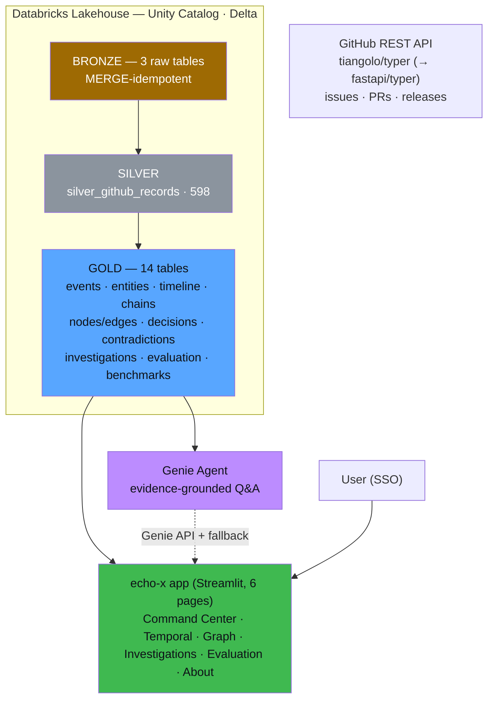

# 🛰️ ECHO-X
### Temporal Intelligence & Forgotten History Reconstruction Engine

> **Connecting fragmented memories to reconstruct historical truth.**

[](https://www.databricks.com/)
[](https://www.python.org/)
[](https://spark.apache.org/)
[](https://delta.io/)
[](https://streamlit.io/)
[](./LICENSE.md)

**Live application:** https://echo-x-7474645617938118.aws.databricksapps.com *(workspace SSO sign-in required)*

---

## 💡 What is ECHO-X?

ECHO-X is an end-to-end **data engineering + AI system on Databricks** that reconstructs the
forgotten history of a software project from its fragmented GitHub records — issues, pull
requests, and releases. Instead of retrieving documents, it **reconstructs history**: structured
events, entities, timelines, a knowledge graph, engineering decisions, contradictions, and
evidence-linked investigations — then answers natural-language questions about *why* things
happened, with a URL to prove every claim.

Its defining discipline is **ELTR (Evidence-Linked Temporal Reconstruction)**:

- every fact is **documented** (traceable to a GitHub URL) or **labeled inference** (confidence-scored)
- contradictions keep **both sides** — they are findings, not bugs
- what cannot be reconstructed is declared as an explicit **gap**
- no timestamp is ever fabricated — every event time equals a real source-record time

## 🧩 The problem it solves

Ask a normal RAG chat “*What happened before release 0.26.0?*” or “*Why was Click vendored?*” and
you get plausible text with fabricated dates, silent contradiction resolution, and zero
provenance. ECHO-X answers from a governed temporal knowledge graph where multi-hop and
time-relative questions become **graph traversal + timestamp arithmetic** — and where
“insufficient evidence” is an acceptable answer.

## ✨ Key features

| Feature | What it does |
| --- | --- |
| 🥇 Medallion pipeline | Bronze → Silver → Gold — 18 Delta tables in Unity Catalog (idempotent MERGE ingestion) |
| 📅 Event & entity extraction | 232 events (10 types, real timestamps only) · 726 entities from 598 records |
| ⏱️ Temporal intelligence | timelines, bug→fix→release chains, technology evolution, release-window analysis |
| 🕸️ Knowledge graph | 958 nodes · 1,618 edges, every edge labeled **documented** or **inferred** + confidence |
| 🧭 Decision reconstruction | 19 decisions with triggers, implementation releases, and outcomes |
| ⚠️ Contradiction detection | 2 real findings — both sides + evidence URLs preserved (incl. a genuine repo org migration) |
| 🔎 ELTR investigations | 19 investigations with verified facts, labeled inferences, confidence scores, declared gaps |
| 🤖 Genie Investigation Assistant | narrative answers grounded in the Gold tables, with the evidence SQL shown |
| 🖥️ Deployed app | read-only premium Streamlit app (six pages) on Databricks Apps with service-principal auth |
| 📊 Rigorous evaluation | 11 data-quality gates + 12-question automated benchmark suite (deterministic SQL scoring) |

## 🏗️ Architecture



Full diagrams (medallion, ELTR, knowledge-graph, application): [`docs/ARCHITECTURE_DIAGRAMS.md`](./docs/ARCHITECTURE_DIAGRAMS.md)

## 🧰 Technology stack

| Layer | Technology |
| --- | --- |
| Platform | Databricks (serverless compute, Unity Catalog governance) |
| Processing | PySpark (DataFrame API, window functions, MERGE) + Spark SQL |
| Storage | Delta Lake tables in Unity Catalog (18 tables) |
| Ingestion | GitHub REST API v3 (pagination + rate-limit handling) |
| AI layer | Databricks Genie agent (attached Gold tables, evidence-grounding instructions) |
| Application | Streamlit on Databricks Apps · Plotly · streamlit-agraph · Databricks SDK |
| Auth | App service principal (OAuth) — read-only `SELECT` grants, no secrets in code |

## 📈 Evaluation results

> Results from the **current dataset (typer GitHub records, 598 Silver rows)** and the **reported
> evaluation run `run_20261101_060656`** — a methodology validation, not a universal guarantee.

| Dimension | Result |
| --- | --- |
| Advanced benchmark questions | **12 / 12 passed (100%)** — knowledge graph · temporal · decision · contradiction · evidence synthesis |
| Correctness / evidence coverage / traceability | 100% · 100% · 100% |
| Temporal / relationship / contradiction handling | 100% · 100% · 100% |
| **Unsupported (hallucinated) claims** | **0.0%** |
| Data-quality gates | 11 / 11 at target (0 fabricated timestamps, 0 chronology violations) |

Full report: [`evaluation/BENCHMARK_RESULTS.md`](./evaluation/BENCHMARK_RESULTS.md) ·
[`docs/RESULTS_AND_EVALUATION.md`](./docs/RESULTS_AND_EVALUATION.md)

## 🖥️ The application (six pages — premium UI)

1. **🛰️ Intelligence Command Center** — live KPI tiles and chart sections, all computed from Gold at view time
2. **⏱️ Temporal Intelligence** — zoomable, tone-coded lane timeline; every event expandable to its GitHub source + Silver record
3. **🕸️ Knowledge Graph Explorer** — interactive graph; green edges documented, amber inferred; incident chains with evidence links
4. **🔎 Investigation Studio** — Genie narrative answers (with evidence SQL) or the deterministic ELTR engine — confidence and evidence URLs always shown
5. **📊 Evaluation & Quality** — recorded benchmark runs, data-quality gates, and evaluation history
6. **ℹ️ About ECHO-X** — methodology, the ELTR discipline, and how to read every number

### Screenshots

Real captures of the running app live in [`screenshots/`](./screenshots/README.md) — see the
exact capture checklist there (the embeds below render once those files are committed):

| Command Center | Temporal Intelligence |
| --- | --- |
|  |  |

| Knowledge Graph | Investigation Studio | Evaluation & Quality |
| --- | --- | --- |
|  |  |  |

## 🚀 Quick start

The full reproduction guide (prerequisites → ingestion → Gold → Genie → benchmarks → deploy,
with verification checklist and troubleshooting) is in
[`docs/EXECUTION_GUIDE.md`](./docs/EXECUTION_GUIDE.md). Summary:

1. Run the pipeline top-to-bottom in a Databricks workspace — the verbatim export is
   [`notebooks/ECHO-X-pipeline.py`](./notebooks/ECHO-X-pipeline.py) (Bronze is idempotent; Silver is derived).
2. Create the Genie space (instructions embedded in the notebook).
3. Deploy the app: `databricks apps deploy echo-x --source-code-path <repo>/apps/echo-x`
4. Grant the app's service principal read-only access to the schema (`GRANT SELECT ON SCHEMA`).

## 📂 Repository structure

```text
ECHO-X/
├── README.md                  ← you are here
├── LICENSE.md                 ← MIT
├── .gitignore
├── apps/echo-x/               ← deployed Streamlit app (Databricks Apps git source)
├── notebooks/                 ← ECHO-X-pipeline.py — verbatim pipeline export + README
├── docs/                      ← full documentation set
│   ├── PROJECT_REPORT.md      ← 20-section project report
│   ├── TECHNICAL_AUDIT.md     ← component-by-component audit
│   ├── ARCHITECTURE_DIAGRAMS.md
│   ├── EXECUTION_GUIDE.md
│   ├── RESULTS_AND_EVALUATION.md
│   ├── LIMITATIONS_AND_ROADMAP.md
│   └── INTERVIEW_PREPARATION.md
├── screenshots/               ← app screenshots (see checklist)
└── evaluation/                ← benchmark artifacts
```

## ⚠️ Limitations & future scope (honest by design)

- Anonymous GitHub API caps issues/PRs at 5 pages (recent history; releases are complete 2019→2026), so early historical years are sparse — reported as-is, never interpolated
- Rule-based extraction — subtle discussions without expected keywords are not extracted (reported honestly as 0)
- Inferred relationships are always labeled and confidence-scored — never presented as documented evidence
- “Rejected” decision status and most rejected alternatives are not recoverable from the available records (declared as gaps, not invented)
- Genie tier needs a one-time space permission; the app falls back to a deterministic engine otherwise
- The 12/12 deterministic benchmarks validate the reconstruction pipeline on this dataset — they do not establish general Genie answer accuracy

Full list + prioritized roadmap: [`docs/LIMITATIONS_AND_ROADMAP.md`](./docs/LIMITATIONS_AND_ROADMAP.md)

## 👤 Author

**Vijayanandhini** — built as a capstone data-engineering portfolio project on Databricks.
Built to be explored: every claimed number above is re-verifiable from the repo's notebook,
the benchmark suite, and the deployed application.

---

*If a fact above has no URL behind it, ECHO-X wouldn't claim it.*