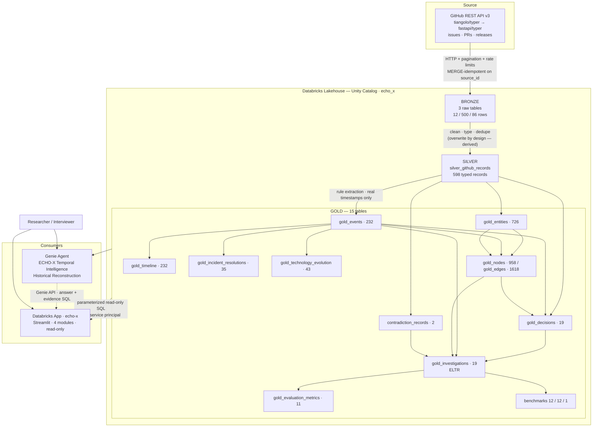
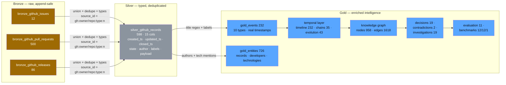
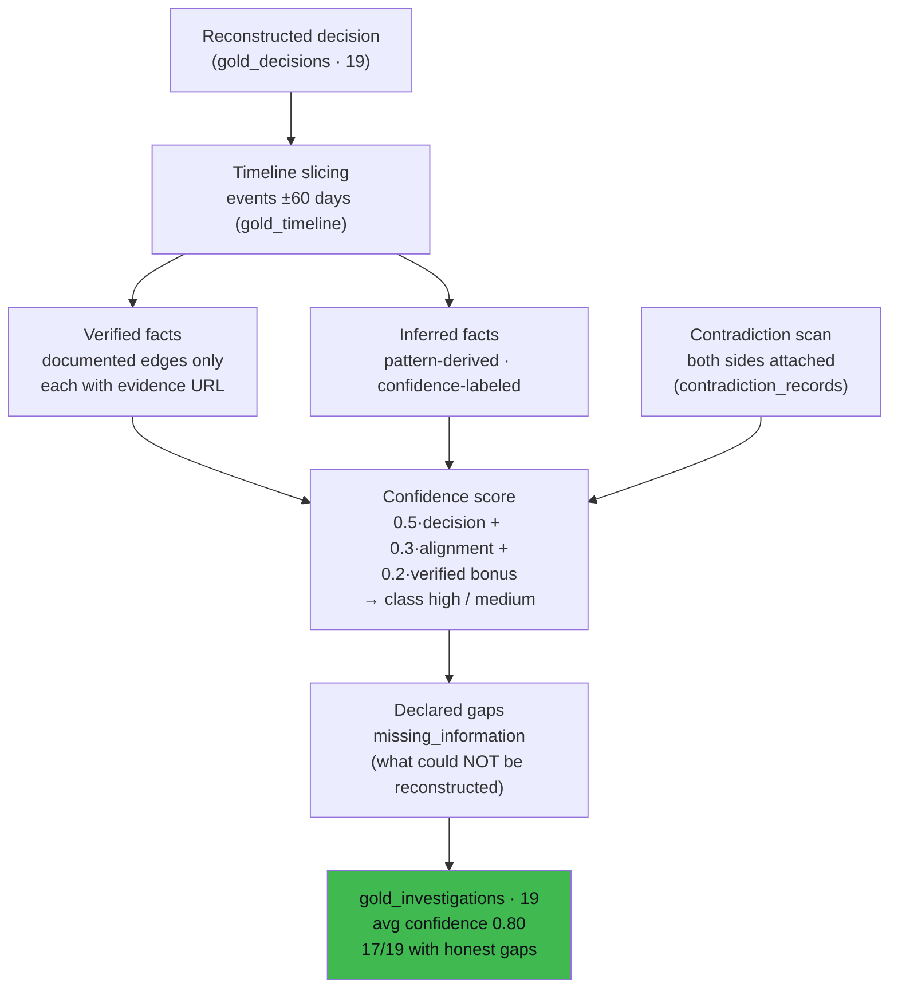
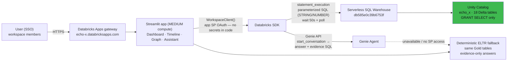

# ECHO-X — Architecture Diagrams

Publication-quality Mermaid diagrams. Render in GitHub, GitLab, VS Code (Markdown Preview
Mermaid), or [mermaid.live](https://mermaid.live).

## 1. Overall ECHO-X Architecture

## 2. Bronze–Silver–Gold Data Pipeline

## 3. ELTR Investigation Workflow

## 4. Knowledge Graph Relationship Model

```mermaid
flowchart LR
    subgraph nodes["Node types (gold_nodes · 958)"]
        EV["event nodes · 232<br/>bug · feature · release ·<br/>deprecation · migration"]
        DV["developer · 117<br/>e.g. tiangolo · dependabot&#91;bot&#93;"]
        TC["technology · 11<br/>python · click · pydantic …"]
        RC["record · 598<br/>issues · PRs · releases"]
    end
    EV -->|"RESOLVED_BY · 25<br/>documented"| EV2["bug_resolution event"]
    EV -->|"IMPLEMENTED_IN · 25<br/>inferred from timestamps"| RL["version_release"]
    EV -->|"PRECEDED_BY · 231<br/>inferred from sequence"| EV
    RL -->|"SUPERSEDED_BY · 85<br/>inferred from release order"| RL
    DV -->|"RELATED_TO · 598<br/>documented authorship"| RC
    TC -->|"RELATED_TO · 654<br/>inferred from mentions"| RC
    style EV fill:#58a6ff,color:#0e1117
    style RL fill:#39c5cf,color:#0e1117
    style DV fill:#bc8cff,color:#0e1117
    style TC fill:#3fb950,color:#0e1117
    style RC fill:#8b949e,color:#0e1117
```

**Legend:** solid labeled edges — documented (evidence URL attached); “inferred” edges —
pattern-derived, confidence-scored, and labeled as such in the app UI (green vs amber).

## 5. Application Architecture

